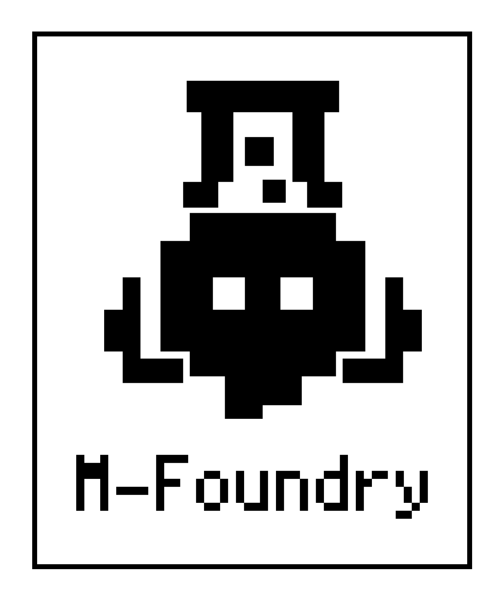

M-Foundry 是独立开发者 [MRoldL001](https://github.com/MRoldL001) 的产品集，以 MChat 为起点，逐步拓展至更多软件与工具，系列产品将会在持续开发与迭代中不断生长

## [MChat](https://github.com/M-Foundry/MChat)

一款为 MiMo 大模型优化，专注于原生 Android 体验的 AI 聊天客户端 

## [MMixedMarkdown LaTeX (M3L)](https://github.com/M-Foundry/MMixedMarkdownLatex)

MMixedMarkdown LaTeX（M3L）是一个面向 Android Jetpack Compose 的 Markdown、LaTeX 与代码高亮渲染器，它从 [MChat](https://github.com/M-Foundry/MChat) 抽离而来，专注于内容渲染

